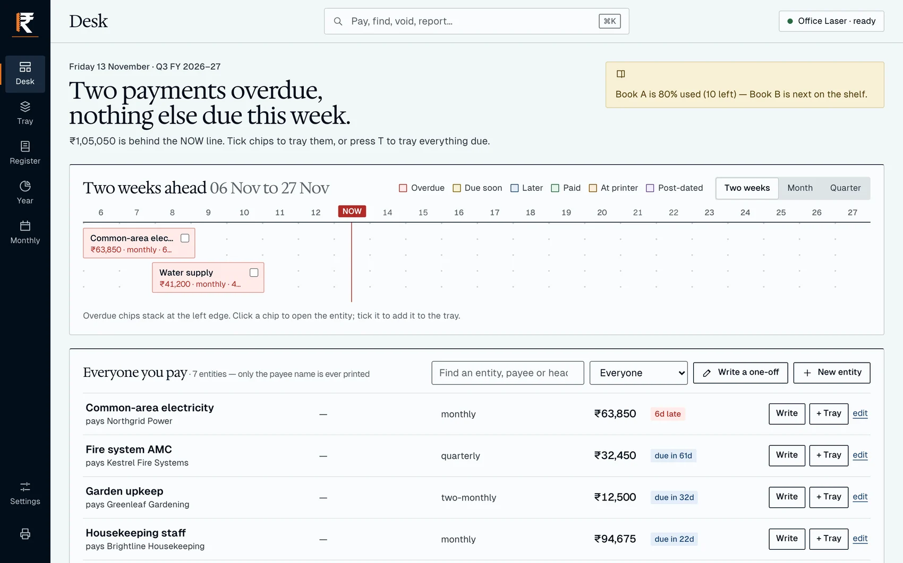

<h1 align="center">
  &nbsp;Banyan — Cheque Desk
</h1>

<p align="center">
  A desktop app for small organisations: writes, prints and logs cheques from one Mac,<br>
  so the only thing left to do by hand is sign them.
</p>

<p align="center">
  <a href="https://satiyap.github.io/banyan/"><b>Website</b></a> ·
  <a href="https://github.com/satiyap/banyan/releases/latest/download/Banyan-mac-arm64.dmg"><b>Download for Mac</b></a> ·
  <a href="https://github.com/satiyap/banyan/releases">Releases</a> ·
  <a href="https://github.com/satiyap/banyan/issues">Issues</a>
</p>

<p align="center">
  
</p>

## What it is

Banyan is for small organisations that pay their bills by cheque: housing societies, clubs, trusts, associations. You type the payee and the amount, and Banyan prints the date, the payee, the amount in words and figures and the A/C payee crossing onto a real bank cheque leaf in your printer, in the right places. Then it records the cheque in a register, so you always know which leaf went where.

It's built for a State Bank of India multi-city cheque (CTS-2010) printed on an HP LaserJet Pro MFP M126nw. Other printers work once you've calibrated them with a test print on plain paper.

## What it does

- **Writes cheques.** Date, payee, amount in words (lakh and crore, the Indian way) and figures, and the crossing, printed at measured positions on the leaf.
- **Keeps the register.** Every leaf used, by cheque book, with its status: printed, logged, voided or failed. Nothing is ever deleted.
- **Knows what's due.** It learns which payments recur and how often, and shows what's due or overdue.
- **Makes the year's reports.** The financial year by expense head, quarter and payee, month-by-head totals as a PDF for the committee, and CSV exports.
- **Shares reports with members.** Connect it to a Banyan server and members can read the reports in a browser. They can't change anything.

The desk works without internet and without a server. The server is optional and adds sync and the members' reports.

## Get it

Download **[Banyan-mac-arm64.dmg](https://github.com/satiyap/banyan/releases/latest/download/Banyan-mac-arm64.dmg)**. It needs a Mac with Apple silicon. The [website](https://satiyap.github.io/banyan/) walks through the screens and how to get started.

If macOS blocks the app the first time you open it, allow it under **System Settings ▸ Privacy & Security ▸ Open Anyway**. That happens when a release is built without an Apple Developer ID.

The first time Banyan checks your printer, macOS asks whether it may find devices on your local network. Allow it, so Banyan can tell whether the printer is switched on. Printing works either way. **Settings ▸ Permissions** shows whether it's allowed, with a coloured dot, and opens System Settings if you need to change it.

**Before you print a real cheque, print the test sheet on plain paper cut to leaf size and hold it against a real leaf.** Every printer feeds paper a little differently, and only a test print shows how yours does.

---

# For developers

## Two halves

The cheque desk has to sit on the same network as the printer. The members' reports have to be reachable from anywhere. One hosted app can't be both, so the repository holds two:

- **The desk** runs on the organisation's Mac. It holds the register, drives the printer and needs no internet.
- **The Banyan server** keeps a copy of the register and serves the members' reports, read-only. The desk pushes every change to it. Nothing reaches in to the desk.

Every rule the desk follows is pinned by recorded answers in `tests/golden/`, which the tests replay. The desk started as a small web app. It became a desktop app without its screens, cheque layout, print CSS, template or calibration changing.

## The Go app (2.0)

From 2.0 the desktop app is written in Go on [Wails 3](https://wails.io). It draws its pages with macOS's own web view, which brings the download down to about 7 MB from about 120 MB for the Electron build. It serves the same pages (`static/`, `templates/`), answers the same recorded sessions in `tests/golden/`, reads the same register file and prints with the same `lp` options. Cheques are rendered to PDF by WebKit instead of Chromium.

You need macOS on Apple silicon, Go 1.26 and the Xcode command line tools.

```sh
sh scripts/build-mac.sh        # development build at dist/Banyan.app
go test ./...                  # the Go desk against the recorded answers
```

A development build has a version ending in `-dev`. It keeps its register in `~/Library/Application Support/Banyan Dev` and **can't print**. `sh scripts/release-mac.sh 2.0.0` builds a signed, notarized `dist/Banyan-mac-arm64.dmg`. It needs a Developer ID identity and a notarytool profile, both named at the top of the script, and it doesn't publish anything.

| Path | What's there |
| --- | --- |
| `cmd/banyan` | The app: window, menus, title bar, saving downloads. |
| `cmd/deskdev` | The desk on its own on a loopback port, for development. It never prints. |
| `internal/desk` | The desk's `/api`, ported from `src/server`. |
| `internal/render`, `internal/webpdf` | Cheque and report PDFs through WebKit, at an exact page size. |
| `internal/printing` | Print queues and `lp`. |
| `internal/db`, `internal/desksync`, `internal/connection` | The register, and its copy on a Banyan server. |
| `cmd/banyan-server`, `internal/server` | The Banyan server: keys, register copies, members' reports. |

## The Electron app (TypeScript)

The TypeScript in `src/` is the Electron app that 2.0 replaces, along with the server it was built with. The container now runs the Go server. `src/backend` stays as the reference it was ported from, and both read and write the same data folder.

You need macOS on Apple silicon, Node 22 or newer, and pnpm 11.

```sh
pnpm install
pnpm dev                 # runs the app, printing off
pnpm package:dir         # a packaged build, which can print
open dist/mac-arm64/Banyan.app
```

| Command | What it does |
| --- | --- |
| `pnpm dev` | Runs the app. Printing is off. |
| `pnpm build` | Builds the main process and the server into `out/`. |
| `pnpm start` | Runs the built app without packaging it. Printing is off. |
| `pnpm typecheck` | Type-checks everything. |
| `pnpm test` | Replays the recordings in `tests/golden/`, and tests the server and sync. |
| `pnpm e2e` | Builds the app, then runs it on a throwaway data folder against a local Banyan server. It connects, renders a test sheet, visits every screen, syncs and signs in to the members' pages. It never prints. |
| `pnpm verify-print` | Renders cheques and measures where the ink lands, against the calibration. Needs poppler and Google Chrome. |
| `pnpm render-check` | Renders one invented cheque with the app's Chromium and with an installed Chrome, and reports both page sizes. |
| `pnpm package` | Builds a `.dmg` into `dist/`. |
| `pnpm package:dir` | Builds just the `.app` into `dist/mac-arm64/`. |
| `pnpm icons` | Regenerates the app icon from `build/icon.svg`. |
| `pnpm server` | Runs only the desk's local server under plain Node, after `pnpm build`. |
| `pnpm build:backend` | Builds the Banyan server into `out/backend/`. |
| `pnpm backend` | Runs the Banyan server, after `pnpm build:backend`. |
| `pnpm release 2.1.0` | Sets the version, tags and pushes a release of the desktop app. |

Inside the app there are three parts:

```
┌──────────────────────── the app ─────────────────────────┐
│                                                           │
│  the desk's pages ── same /api routes ──▶ local server    │
│  (static/, unchanged)                        │            │
│                                              ▼            │
│  main process ◀── "render this page" ── compose cheque    │
│  built-in Chromium ── PDF ─────────────▶ check page size  │
│                                              │            │
│                                              ▼            │
│                                   print queue (lp), register
└───────────────────────────────────────────────────────────┘
```

- **The pages** are plain HTML, CSS and JavaScript with no build step. The window loads them from the local server.
- **The local server** (`src/server`) has all the logic and data: routes, JSON and the register file. It listens on loopback only and needs a secret that's regenerated at every launch and handed only to the app's own window.
- **The main process** (`src/main`) owns the window, the menus and the Chromium that turns a composed page into a PDF.

## How a cheque is printed

1. The server composes one self-contained page from the print template, `cheque.css`, `cheque-layout.js` and the cheque's data.
2. The app's own renderer prints that page to a PDF. There's no print dialog, so nothing can rescale it.
3. The PDF's page size is read back. It has to be 92 × 204 mm, to within 0.5 mm, on exactly one page, or it's refused.
4. The PDF goes to the print queue through `lp` with a custom 92 × 204 mm media size, fit-to-page off and scaling pinned at 100%.
5. The cheque then waits as "awaiting confirmation" until someone at the desk says the leaf came out right. A finished print job doesn't prove the leaf printed correctly. A batch prints its first leaf alone and waits for that answer before the rest go.

Because the renderer ships inside the app, every install renders the same page, and the renderer only changes when the app does. `pnpm render-check` compares the Electron app's Chromium with an installed Google Chrome.

## Connecting to a Banyan server

On first launch the app asks for the server's address and then a key. No address ships with the app. Anyone can download it, but only someone given both can reach the organisation's server. **Skip for now** is a complete answer: the desk writes and prints without a server and doesn't ask again. **Settings** (in the rail, or **Banyan ▸ Settings…**, ⌘,) reopens the screen. There, **Switch key** replaces the key for the same server, **Reset key** forgets the key but keeps the address, and **Change the address** is for when the server moves.

- **The address is checked first.** The app calls `GET /api/v1/info` and only accepts a Banyan server it understands. It doesn't ask for the key until one answers, so a mistyped address never sees it.
- **A key works once.** Connecting trades it for a token the app keeps in `connection.json`, and the key is spent.
- **The key decides what the app becomes.** A write key makes it the cheque desk. A read key makes it a reports-only app: the Year and Monthly pages, fetched from the server each time, with the desk, register and printing closed. No register is downloaded to a reader's Mac, and one already there is neither shown nor sent.
- **Every change goes to the server** straight away, and again when the app quits and opens, to catch anything that didn't get through. The title bar shows when the server last had the register, or why it doesn't.
- **One desk writes at a time.** Connecting a new desk retires the old one, which then says so in its title bar.
- **If the desk and the server have different registers**, nothing is sent or fetched until the connection screen gets an answer about which one is right. Choosing the server's copy fetches it and restarts the app. The register it replaces is kept beside it as `banyan.db.before-restore-<time>`.

That last step is also how a register moves to a new Mac: install the app, connect with a new write key, and choose the server's register.

## The Banyan server

`cmd/banyan-server` is a small Go server (`internal/server`). It does four things:

- **Discovery.** `GET /api/v1/info` is open to anyone. It returns the server's name, its API version and what it can do, and nothing about the register.
- **Keys.** `POST /admin/keys`, with the admin token, issues a single-use `write` or `read` key that's valid for a week. Redeeming it gives a long-lived token.
- **The register.** The writing desk sends the whole register file after every change (`PUT /api/v1/register`). Each copy is numbered, and the desk has to say which number it started from, so a desk that's behind can't overwrite a newer register. The last 200 copies are kept.
- **Members' reports.** At `/`, anyone with a key signs in and sees the desk's own Year and Monthly pages, drawn from the latest register by the same code. Nothing there writes, and the register file only ever goes to the writing desk.

Run it locally:

```sh
BANYAN_ADMIN_TOKEN=$(openssl rand -hex 32) BANYAN_INSECURE_COOKIES=1 go run ./cmd/banyan-server     # http://127.0.0.1:8322
go test ./internal/server/
```

Issue a key (there's no admin page yet):

```sh
curl -X POST https://<the server>/admin/keys \
  -H "Authorization: Bearer $BANYAN_ADMIN_TOKEN" -H "Content-Type: application/json" \
  -d '{"role": "write", "label": "treasurer"}'
```

| Setting | What it is |
| --- | --- |
| `PORT` | Where it listens. Default 8322. |
| `DATA_DIR` | Keys, tokens and register copies. `/data` in the container. |
| `BANYAN_ADMIN_TOKEN` | Lets its holder issue keys. It has to be at least 32 random characters (`openssl rand -hex 32`) or the server won't start. If it's unset, no keys can be issued. Wrong attempts are limited to eight per address every ten minutes. |
| `BANYAN_SERVER_NAME` | The name the server gives to apps that connect, such as the organisation's name. |
| `BANYAN_INSECURE_COOKIES` | `1` only when running over plain http on one machine. |

It ships as a container (`Dockerfile`), runs as user 1000, has a health check at `/healthz` and needs one volume for its data.

## Where the data lives

Everything is in `~/Library/Application Support/Banyan/`:

| File | What it is |
| --- | --- |
| `banyan.db` | The register. This is financial data. |
| `cheque-calibration.json` | Measured field positions for this desk's printer. It's copied from the shipped default on first launch, and after that it's yours to edit. The app picks up edits without a restart. |
| `connection.json` | The server's address and this desk's token, or a note that connecting was skipped. It's plain text because the server can retire a token, and does when another desk takes over. |
| `sync.json` | Which copy of the register the desk and the server last agreed on. |
| `cheques/` | Rendered PDFs. Safe to delete. |
| `static/leaf-photo.jpg` | The backdrop for the on-screen preview: a photo of a real leaf with the account number, account name and MICR band blacked out, the anti-copy patch blurred and the resolution halved. It ships with the app, and a copy in the data folder's `static/` replaces it. |

**Help ▸ Show Register in Finder** and **Show Calibration File in Finder** open them. The register starts empty, and no register is ever committed to this repository.

The register's file format hasn't changed since the first version of the desk, so an older `banyan.db` opens as it is. Quit the app and copy it to `~/Library/Application Support/Banyan/banyan.db`. From then on, write cheques from one copy only. Two desks writing separate copies will hand out the same leaf numbers.

## Tests

The recordings in `tests/golden/` are the answers the desk's rules gave on invented inputs. The tests replay them and the answers have to come out the same. The rules were first written in Python and recorded from that code, which is why a few helpers (`src/server/pycompat.ts`) reproduce Python's rounding, sorting and text handling exactly.

| Area | Recorded cases |
| --- | --- |
| Amounts in words and figures | 10,684 |
| Calibration loading and validation | 2,816 |
| Leaves and cheque books | 2,674 |
| Date rules and reminders | 44,120 |
| Cadence and summaries | 225 register runs |
| Financial-year and monthly reports | 1,200 calls |
| The register (SQLite) | 513 operations in 17 scenarios, plus opening a register written by an earlier desk |
| The HTTP API | 806 requests across every route but one |

The server and desk-to-server sync aren't recorded. `src/backend/backend.test.ts` tests them directly, including a handover between two desks.

A failing replay means behaviour changed. If the change is intended, update the affected recorded case by hand in the same commit. All recorded data is invented: fictitious payees, amounts and leaf numbers.

## Releases and CI

| Workflow | Runs on | What it does |
| --- | --- | --- |
| `ci.yml` | A push to `main`, or a pull request that changes code. Changes to docs and `*.md` alone don't trigger it. | Typecheck, unit tests, the app end to end. |
| `image.yml` | A push to `main` that changes something in the server image. | Builds `ghcr.io/satiyap/banyan` on a GitHub-hosted ARM64 runner. |
| `release.yml` | A `v*` tag. | Runs the Go tests, builds the Go app (`scripts/build-mac.sh`) into `Banyan-mac-arm64.dmg` and publishes a GitHub release. |

`pnpm release 2.1.0` sets the version in `package.json`, tags `v2.1.0` and pushes, and the tag builds and publishes the release. The workflow refuses a tag that doesn't match `package.json`. The latest disk image is always at `releases/latest/download/Banyan-mac-arm64.dmg`.

A release is signed and notarized when the repository holds an Apple Developer ID certificate. The secrets are listed at the top of `release.yml`. Without one the release is ad-hoc signed, and macOS will ask for **Open Anyway** the first time.

## Roadmap

- An admin page for issuing keys. For now keys are issued with `curl`.
- Better member sign-in. Today it's one key per browser, and sessions can only be seen or revoked through the admin routes.
- The monthly PDF on the members' pages. It's drawn by the desk's browser engine, which the server doesn't have.
- A plain-paper test print from the desktop app. Its rendered page matches the reference renderer's, but nothing has been printed from it yet.
- Developer ID signing and auto-update. For now a new version is a new download.
- Windows. Printing currently goes through the Mac's `lp`.
- An off-site backup of the server's volume. The server keeps 200 copies of the register, but they're all on one volume.

## Contributing

See [CONTRIBUTING.md](.github/CONTRIBUTING.md). Coding agents, and anyone changing the cheque layout, should read [`AGENTS.md`](AGENTS.md) first. It has the physical facts (leaf and page sizes, the MICR band, the printer's unprintable margin), the geometry contract, the register's rules and what to check after a change. To report a security problem, see [SECURITY.md](.github/SECURITY.md).

## Licence

Apache License 2.0, in [`LICENSE`](LICENSE). Copyright 2026 Banyan contributors. The software comes with no warranty, so check every cheque before you sign it.

The bundled fonts are under the SIL Open Font License, and their licence texts are in `static/fonts/`.
